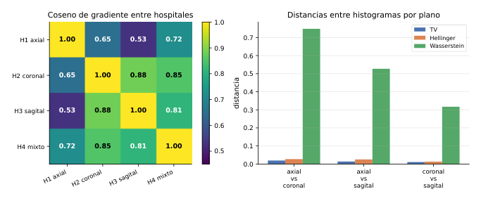
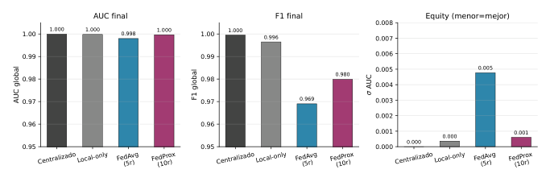
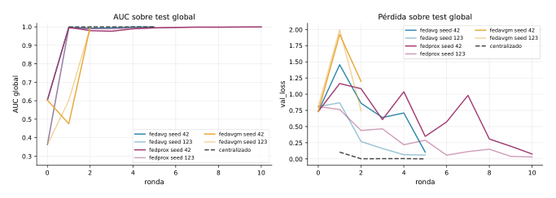
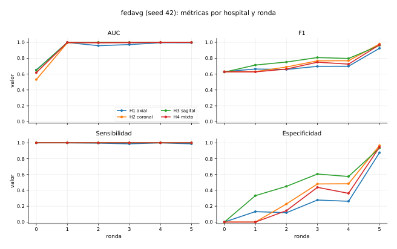
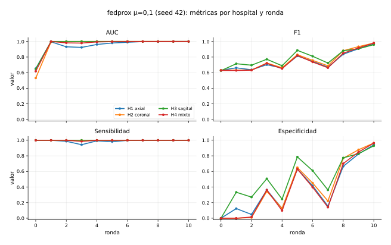
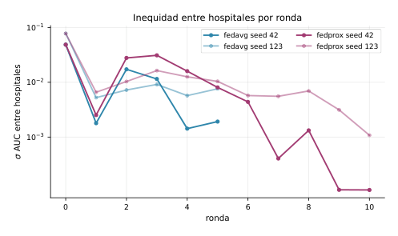
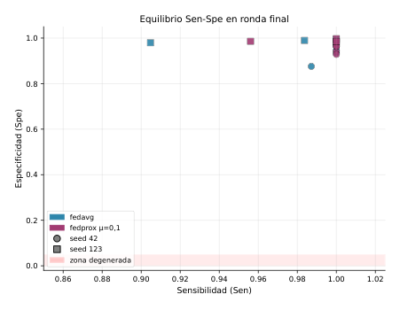

[English](README.md) | **Español**

# Aprendizaje federado por transferencia entre planos anatómicos

Pablo Jesús Delgado Muñoz, María Vázquez López, Paola Gambero Díaz. Universidad de Málaga.

**[Paper en PDF](paper.pdf)**

## Abstract

En este trabajo abordamos el Proyecto 6 de la asignatura, que plantea un escenario de aprendizaje federado por transferencia (FTL) para clasificar imágenes MRI-FLAIR como Esclerosis Múltiple (EM) o control. Los cuatro hospitales simulados usan todos la misma modalidad, pero cada uno adquiere las imágenes en un plano anatómico distinto: axial, coronal, sagital (o mixto). Esto introduce un cambio de dominio visual que convierte el problema en FTL en lugar de aprendizaje federado horizontal clásico.

Antes de entrenar caracterizamos la heterogeneidad entre hospitales en tres espacios distintos y encontramos que la diferencia real no está en los píxeles sino en el espacio del gradiente, donde el coseno medio entre clientes es 0,74. Comparamos FedAvg y FedProx frente a cotas de entrenamiento local y centralizado, usando ResNet-18 sin preentrenamiento. FedAvg converge en 5 rondas con AUC = 0,998 y F1 = 0,969. FedProx con mu = 0,1 necesita 10 rondas para obtener resultados similares (AUC = 0,9996, F1 = 0,980) debido a que su término proximal le cuesta arrancar cuando el modelo global inicial está en un estado degenerado. FedAvgM diverge a NaN en la ronda 3 por amplificación del sesgo entre clientes. La conclusión principal es que FedAvg es la opción más robusta y eficiente para este nivel de heterogeneidad.

**Palabras clave:** aprendizaje federado por transferencia, imagen médica, MRI-FLAIR, FedAvg, FedProx, FedAvgM, ResNet-18.

## 1. Introducción

El aprendizaje federado (AF) permite entrenar un modelo compartido sobre datos repartidos en varios clientes sin necesidad de moverlos a un servidor central, intercambiando solo los parámetros del modelo [1]. Esto resulta muy útil en el entorno sanitario, donde los datos de los pacientes están protegidos por normativas como el RGPD que impiden su centralización fuera del centro de origen [3]. Además, un único hospital suele tener demasiados pocos datos etiquetados para entrenar un modelo fiable por sí solo. La federación ofrece una solución: aprovechar los datos de todos sin que nadie tenga que cederlos.

El caso más estudiado en la materia es el aprendizaje federado horizontal (HFL), donde todos los clientes trabajan con el mismo tipo de datos y la misma tarea, y solo difieren en las muestras concretas que tienen. El reto en HFL es la heterogeneidad estadística: si los datos de cada cliente tienen distribuciones muy distintas (escenario no-IID), la media de pesos puede converger más lento o incluso hacia un modelo peor que los locales. Sin embargo, en la práctica hospitalaria existe otro tipo de heterogeneidad más difícil de manejar: distintos hospitales pueden adquirir las mismas imágenes con protocolos diferentes, lo que introduce diferencias visuales entre clientes. Cuando los clientes ven el mismo tipo de imagen en modalidad pero con características visuales distintas, como ocurre al cambiar el plano de corte anatómico, hablamos de aprendizaje federado por transferencia (FTL). La clave es que el espacio de etiquetas Y(k) es igual en todos los clientes pero el espacio de entrada X(k) no lo es, porque el mismo cerebro visto desde axial, coronal o sagital genera imágenes visualmente muy diferentes para una red convolucional.

### Contexto clínico

La Esclerosis Múltiple (EM) es una enfermedad inflamatoria desmielinizante del sistema nervioso central que afecta a más de dos millones de personas en el mundo. Su diagnóstico se apoya en la resonancia magnética, especialmente en secuencias FLAIR (*Fluid-Attenuated Inversion Recovery*), donde las lesiones desmielinizantes periventriculares aparecen como hiperintensidades bien delimitadas al suprimirse la señal del líquido cefalorraquídeo. Distintos centros adquieren estos volúmenes en planos diferentes según su protocolo habitual: el axial es el más habitual para cuantificar la carga lesional total, el coronal se usa para la fosa posterior y los lóbulos temporales, y el sagital para evaluar la banda callosa. Esta variabilidad de planos entre centros es exactamente el escenario FTL que estudiamos: la tarea clínica es la misma en todos los hospitales, pero la apariencia de las imágenes cambia radicalmente de un plano a otro.

En este proyecto simulamos cuatro hospitales que trabajan todos con secuencias FLAIR para clasificar EM frente a control, pero cada uno usa un plano de corte diferente. El objetivo es analizar si un modelo federado puede integrar la información de estas cuatro vistas y generalizar correctamente a todas ellas, comparando qué algoritmo de AF lo hace mejor con menor coste de comunicación.

**Trabajo relacionado.** McMahan et al. [1] propusieron FedAvg, que promedia los pesos de los clientes ponderando por número de muestras y es el algoritmo de referencia en AF. Li et al. [2] analizaron los principales retos del AF en escenarios no-IID, entre ellos el *client drift*, que ocurre cuando los clientes se alejan demasiado del modelo global al entrenar localmente varias épocas. Para corregirlo, el mismo grupo propuso FedProx [4], que añade un término proximal a la pérdida local limitando cuánto puede alejarse cada cliente del modelo global. Hsu et al. [5] extendieron FedAvg con momento en el servidor (FedAvgM) para acelerar la convergencia, aunque con mayor sensibilidad a la heterogeneidad entre clientes. En imagen médica federada, Kaissis et al. [3] discuten las implicaciones de privacidad y los retos de robustez específicos del dominio clínico. La arquitectura base usada, ResNet-18, fue propuesta por He et al. [6] y es un estándar en tareas de clasificación de imagen médica.

El informe se organiza así: la Sección 2 define el problema como red de AF; la Sección 3 describe los algoritmos y la implementación; la Sección 4 presenta los experimentos con todos los resultados; la Sección 5 recoge las conclusiones y el trabajo futuro.

## 2. Formulación del problema

### Conjunto de datos

Los datos provienen de la base MRI-MS-KDE, que contiene cortes 2D de MRI en modalidad FLAIR de pacientes con EM y controles sanos en tres planos anatómicos. Todas las imágenes pasan por un preprocesado KDE (*Kernel Density Estimation*) que normaliza el histograma de intensidades. Esto elimina las diferencias de contraste entre equipos y deja como única variación inter-cliente el plano de corte. Las etiquetas son por paciente: todos los cortes de un paciente con EM se etiquetan como EM, aunque en algún corte concreto no haya lesión visible.

La partición federada asigna un plano a cada hospital simulado (Tabla 1). La proporción de casos EM en entrenamiento es del 60 % en todos los hospitales, así que no hay desbalance de clases entre clientes. La heterogeneidad es puramente visual.

**Tabla 1.** Distribución del conjunto de datos por hospital.

| Hospital | Plano | Slices train | Slices test | EM |
|---|---|---|---|---|
| H1 | axial | 3 458 | 1 183 | 0,605 |
| H2 | coronal | 4 142 | 1 417 | 0,605 |
| H3 | sagital | 3 458 | 1 001 | 0,605 |
| H4 | mixto | 3 583 | 1 073 | 0,619 |
| Global | - | - | 4 674 | 0,459 |

### Red de aprendizaje federado

**Nodos.** Cada nodo k en {1, 2, 3, 4} es un hospital simulado con sus propios cortes de un plano anatómico concreto. Verificamos que no hay solapamiento de pacientes ni entre hospitales ni entre las particiones de entrenamiento y test.

**Modelos locales.** Todos los clientes usan la misma arquitectura: ResNet-18 sin preentrenamiento [6], con la última capa totalmente conectada sustituida por una proyección lineal a un único logit. Las imágenes se cargan en escala de grises, se replican a 3 canales para encajar con la entrada esperada por la ResNet, y se redimensionan a 224 x 224 px para eliminar diferencias de resolución entre planos. El número total de parámetros es |w| = 11,177 M.

**Función de pérdida local.** Usamos BCEWithLogitsLoss, que aplica sigmoide al logit internamente antes de calcular la entropía cruzada binaria, lo que es numéricamente más estable que hacerlo por separado:

```
(1)  L_k(w) = -(1/n_k) * sum_{i=1..n_k} [ y_i * log(sigmoid(f_w(x_i))) + (1 - y_i) * log(1 - sigmoid(f_w(x_i))) ]
```

**Por qué este escenario es FTL.** Todos los hospitales resuelven la misma tarea (Y(k) = Y para todo k), pero cada uno observa el cerebro desde un plano distinto, por lo que X(k) != X(k'). La distribución marginal de entrada P(X) cambia entre clientes mientras que P(Y|X) es la misma. Eso define FTL: el modelo global tiene que transferir lo aprendido en un plano a los demás, no solo promediar parámetros de clientes con datos similares como en HFL.

**Topología.** Usamos una topología estrella centralizada: los K = 4 clientes solo se comunican con el servidor. Al comienzo de cada ronda el servidor envía w_g(t) a todos los clientes; estos entrenan E épocas localmente y devuelven w_k(t+1). Las aristas tienen peso n_k / sum_j n_j, proporcional al número de muestras.

### Caracterización de la heterogeneidad

Para entender mejor el problema antes de entrenar, cuantificamos la diferencia entre hospitales en tres espacios distintos. Las **distancias entre histogramas de intensidad** (TV, Hellinger, Wasserstein-1) miden la diferencia a nivel de píxel sin tener en cuenta la estructura espacial. Las **distancias entre embeddings** de una ResNet-18 sin entrenar (Fréchet, coseno entre medias de características) comparan las representaciones en el espacio de características. Las **similitudes de gradiente** (coseno, norma de la diferencia) miden cómo de parecidas son las actualizaciones que cada cliente haría si partiesen del mismo modelo.

**Tabla 2.** Resumen de heterogeneidad (media de los 6 pares posibles).

| Métrica | Espacio | Valor medio |
|---|---|---|
| Total Variation entre histogramas | Píxeles | 0,015 |
| Hellinger entre histogramas | Píxeles | 0,022 |
| Wasserstein-1 entre histogramas | Píxeles | 0,53 |
| Distancia Fréchet entre embeddings | Features | 86,3 |
| Coseno entre embeddings ResNet | Features | 0,977 |
| Coseno de gradiente local | Gradientes | 0,739 |
| \|\|grad_i - grad_j\|\|_2 | Gradientes | 5,11 |

Los resultados de la Tabla 2 y la Figura 1 revelan algo importante: el preprocesado KDE hace que los hospitales sean casi idénticos en píxeles (TV = 0,015) y también muy similares en el espacio de representaciones aprendidas (coseno embeddings = 0,977). Sin embargo, en el espacio del gradiente la similitud media baja a 0,739, con un mínimo de 0,525 entre H1 axial y H3 sagital. Si nos hubiésemos quedado solo con los histogramas habríamos concluido que los clientes son casi iguales, cuando en realidad difieren bastante en cómo optimizan el modelo.



**Fig. 1.** Izquierda: coseno entre gradientes locales de cada par de hospitales. Derecha: distancias entre histogramas de intensidad por par de planos.

## 3. Métodos

### Medida de variación

Para cuantificar la diferencia entre modelos de distintos clientes usamos la distancia euclídea cuadrada entre sus parámetros:

```
(2)  phi(w_i - w_j) = ||w_i - w_j||_2^2
```

Esta medida aparece de forma explícita en el término proximal de FedProx y está implícita en el pseudo-gradiente de FedAvgM.

### Algoritmos federados

Llamamos w_g(t) a los pesos globales al comienzo de la ronda t y w_k(t+1) a los del cliente k después de E épocas locales con Adam (eta = 1e-5).

**FedAvg [1].** El servidor calcula la media de los pesos locales ponderando por el número de muestras de cada cliente, sin ningún tipo de regularización ni memoria entre rondas:

```
(3)  w_g(t+1) = sum_{k=1..K} (n_k / sum_j n_j) * w_k(t+1)
```

Es el algoritmo de referencia y el punto de partida para comparar cualquier variante.

**FedProx [4].** Modifica la pérdida local añadiendo un término proximal que limita cuánto puede alejarse cada cliente del modelo global:

```
(4)  L_prox_k(w) = L_k(w) + (mu / 2) * ||w - w_g(t)||_2^2
```

La agregación en el servidor es la misma que FedAvg; la diferencia está solo en el entrenamiento local. Se implementa en `train_utils.py`: cuando `mu > 0` se guarda una copia de w_g(t) antes de comenzar la época y se añade el término proximal a la pérdida en cada batch.

**FedAvgM [5].** Añade momento al servidor usando el pseudo-gradiente:

```
(5)  g_t = w_g(t) - sum_k (n_k / sum_j n_j) * w_k(t+1)
(6)  m_t = beta * m_(t-1) + g_t
(7)  w_g(t+1) = w_g(t) - eta_s * m_t
```

Usamos beta = 0,5 y eta_s = 0,5, que dan un paso efectivo en estado estacionario de eta_s / (1 - beta) = 1,0, igual al de FedAvg. Elegimos esta configuración conservadora a propósito para darle las mejores condiciones posibles al algoritmo.

### Cotas de referencia

Entrenamos dos baselines. El *local-only* entrena un modelo por separado en cada hospital durante T x E épocas, sin comunicación alguna. Si el modelo federado no supera al local, la federación no aporta nada en ese hospital. El *centralizado* junta todos los datos de los cuatro hospitales y entrena un único modelo con el mismo presupuesto de cómputo; es la cota superior teórica, que en la práctica sería imposible por razones de privacidad. Además, es imposible que un modelo de aprendizaje federado sea mejor que uno centralizado en cualquier caso posible.

### Infraestructura

La implementación usa Flower [7] con PyTorch sobre GPU NVIDIA RTX serie 4000. Los cuatro clientes se ejecutan como actores Ray de forma secuencial. Para reproducibilidad, la semilla de cada cliente y ronda se calcula como `seed_base + cid + round`.

### Hiperparámetros

La Tabla 3 recoge la configuración completa. Todos los algoritmos usan el mismo presupuesto de cómputo para poder compararlos de forma justa. Entrenamos sin pesos preentrenados porque en sino los tres algoritmos saturan el AUC ~ 1 desde la primera ronda y no se puede distinguir cuál funciona mejor.

**Tabla 3.** Hiperparámetros del experimento (ResNet-18 sin preentrenamiento).

| Parámetro | Valor | Comentario |
|---|---|---|
| Inicialización | pesos aleatorios | sin preentrenamiento |
| Épocas locales E | 2 | por ronda y cliente |
| Tasa de aprendizaje | 1e-5 | Adam |
| Tamaño de batch | 32 | |
| Gradient clipping | 0,5 | evita gradientes explosivos |
| Weight decay | 1e-4 | regularización L2 |
| Semillas | {42, 123} | dos repeticiones |
| mu FedProx | 0,1 | término proximal |
| beta FedAvgM | 0,5 | momento servidor |
| eta_s FedAvgM | 0,5 | lr servidor |
| Rondas FedAvg/FedAvgM | 5 | |
| Rondas FedProx | 10 | necesita más para converger |

### Métricas de evaluación

Usamos AUC-ROC (robusto al umbral y al desbalance de clases), F1-score con umbral 0,5, sensibilidad y especificidad por separado, y Brier score para valorar la calibración de las probabilidades. La equidad entre hospitales se mide con sigma({AUC_k}): cuanto más bajo, más uniforme el rendimiento entre clientes. El coste de comunicación es 2|w| x 4 ~ 85,3 MB por ronda (ida y vuelta).

## 4. Experimentos numéricos

### Resultados globales

La Figura 2 y la Tabla 4 muestran las métricas finales. Los baselines centralizado y local-only alcanzan resultados casi perfectos, lo que confirma que la tarea es relativamente sencilla una vez que el preprocesado KDE normaliza las imágenes. Entre los algoritmos federados, FedAvg es el mejor en términos de eficiencia: alcanza AUC = 0,998 y F1 = 0,969 en solo 5 rondas. FedProx llega a resultados algo mejores (AUC = 0,9996, F1 = 0,980), pero necesita 10 rondas, lo que supone el doble de coste en comunicación. FedAvgM no converge en ninguna de las dos semillas.



**Fig. 2.** Comparativa de AUC, F1 y equidad finales entre todos los métodos. FedAvgM no aparece por haber divergido.

**Tabla 4.** Métricas finales sobre el test global.

| Método | AUC | F1 | Sen / Spe | Equity |
|---|---|---|---|---|
| Centralizado | 1,0000 | 0,9995 | 0,9995 / 0,9996 | 0,0000 |
| Local-only | 0,9998 | 0,9965 | 0,9959 / 0,9975 | 0,0004 |
| FedAvg (5 r.) | 0,998 +/- 0,001 | 0,969 +/- 0,009 | 0,984 / 0,960 | 0,005 |
| FedProx (10 r.) | 0,9996 +/- 0,0001 | 0,980 +/- 0,008 | 0,994 / 0,970 | 0,001 |
| FedAvgM | NaN | diverge en r3, ambas semillas | | |

### Convergencia

La Figura 3 muestra las trayectorias de AUC y val_loss. FedAvg sube a AUC alto ya en la primera ronda y la pérdida baja de forma continua hasta 0,06-0,11 en ronda 5. FedProx también sube rápido en AUC pero su val_loss oscila bastante en las primeras rondas y no se estabiliza hasta la ronda 7-8; necesita las 10 rondas completas para terminar de encontrarse. FedAvgM llega a NaN en la ronda 3 en las dos semillas y ahí se detiene.



**Fig. 3.** Trayectorias de AUC y val_loss sobre el test global por ronda. FedAvgM se interrumpe en r3 al divergir a NaN.

### Análisis por hospital

Las Figuras 4 y 5 detallan las cuatro métricas por hospital a lo largo de las rondas para FedAvg y FedProx (semilla 42).

Con FedAvg los cuatro hospitales convergen de forma parecida. La especificidad arranca en 0 porque el modelo empieza prediciendo casi siempre EM (la clase mayoritaria en train), pero despega a partir de la ronda 3 y acaba por encima de 0,87 en todos los hospitales. H1 axial es el más lento, tiene sentido porque es el plano más distinto en el espacio del gradiente (coseno mínimo 0,525 frente a H3 sagital).

FedProx tiene el mismo problema inicial con la especificidad, pero tarda más en resolverlo. Esto ocurre porque el término proximal ancla cada cliente al modelo global, que al inicio es un predictor casi siempre positivo. Con mu = 0,1 el anclaje no es demasiado fuerte y el modelo acaba convergiendo, pero necesita bastantes más rondas. En ronda 5 la especificidad de FedProx en H1 es solo 0,63, mientras que FedAvg ya está en 0,88.



**Fig. 4.** FedAvg (semilla 42): AUC, F1, sensibilidad y especificidad del modelo agregado evaluado sobre cada hospital por ronda.



**Fig. 5.** FedProx mu = 0,1 (semilla 42): mismas métricas en 10 rondas. La especificidad oscila en las primeras rondas y no se estabiliza hasta la ronda 7-8.

### Equidad y métricas finales por hospital

La Figura 6 muestra la desviación estándar del AUC entre hospitales por ronda. FedAvg termina con sigma = 0,0048, lo que supone menos de un 0,5 % de diferencia entre el mejor y el peor hospital. FedProx llega a sigma = 0,0006 al final de sus 10 rondas, una equidad mayor. En la Figura 7 se ve que FedAvg agrupa todos los hospitales en la esquina superior derecha (Sen ~ 0,99, Spe ~ 0,94-0,99), mientras que FedProx tiene un rango ligeramente más amplio en especificidad.



**Fig. 6.** Desviación estándar del AUC entre hospitales por ronda. Escala logarítmica.



**Fig. 7.** Sensibilidad frente a especificidad en la ronda final, por algoritmo, semilla y hospital. La esquina superior derecha es el objetivo; la banda inferior es el predictor que siempre dice positivo.

La Tabla 5 detalla los resultados finales por hospital y semilla. H1 axial es el más difícil: tiene el F1 más bajo en FedAvg (0,926-0,938) y la especificidad más baja en FedProx (semilla 42 acaba en 0,942 tras 10 rondas). H2 y H3 son los más fáciles; H4 (mixto) queda en posición intermedia.

**Tabla 5.** Métricas finales del modelo agregado por algoritmo, semilla y hospital.

| Alg. | Semilla | Hospital | AUC | F1 | Sen | Spe |
|---|---|---|---|---|---|---|
| FedAvg (r5) | 42 | H1 axial | 0,9953 | 0,9261 | 0,9872 | 0,8760 |
| | | H2 coronal | 1,0000 | 0,9805 | 1,0000 | 0,9659 |
| | | H3 sagital | 0,9998 | 0,9619 | 1,0000 | 0,9341 |
| | | H4 mixto | 0,9992 | 0,9694 | 1,0000 | 0,9467 |
| | 123 | H1 axial | 0,9820 | 0,9383 | 0,9048 | 0,9796 |
| | | H2 coronal | 1,0000 | 0,9962 | 1,0000 | 0,9934 |
| | | H3 sagital | 1,0000 | 0,9902 | 1,0000 | 0,9835 |
| | | H4 mixto | 0,9986 | 0,9857 | 0,9837 | 0,9897 |
| FedProx (r10) | 42 | H1 axial | 0,9997 | 0,9672 | 1,0000 | 0,9419 |
| | | H2 coronal | 1,0000 | 0,9798 | 1,0000 | 0,9646 |
| | | H3 sagital | 0,9999 | 0,9589 | 1,0000 | 0,9286 |
| | | H4 mixto | 0,9997 | 0,9791 | 1,0000 | 0,9639 |
| | 123 | H1 axial | 0,9975 | 0,9694 | 0,9560 | 0,9859 |
| | | H2 coronal | 1,0000 | 0,9985 | 1,0000 | 0,9974 |
| | | H3 sagital | 1,0000 | 0,9913 | 1,0000 | 0,9853 |
| | | H4 mixto | 0,9999 | 0,9909 | 1,0000 | 0,9845 |
| FedAvgM | - | - | NaN en r3, ambas semillas | | | |

### Por qué FedAvgM diverge

FedAvgM falla por un problema de amplificación. Al inicio del entrenamiento el modelo global parte de pesos aleatorios y tiende a predecir casi siempre EM, que es la clase mayoritaria en train. Los cuatro clientes coinciden en empujar el sesgo en la misma dirección (hacia positivo) en las primeras rondas. El momento del servidor acumula esa dirección ronda a ronda sin freno. En la ronda 3 los logits crecen tanto que la sigmoide devuelve exactamente 1 con error de redondeo y la BCE se hace infinita.

Intentamos prevenirlo usando beta = 0,5 y eta_s = 0,5 (paso efectivo igual al de FedAvg), más gradient clipping y otras técnicas, pero no fue suficiente. La regularización ralentiza el problema pero no lo elimina. Para que FedAvgM funcione, aquí habría que o bien reducir beta a menos de 0,1, o bien corregir el sesgo de los logits en el servidor antes de acumular el momento.

### Coste de comunicación

Cada ronda supone transferir 2 x 11,177M x 4 ~ 85,3 MB entre servidor y clientes. Con 5 rondas FedAvg acumula ~426 MB en total, mientras que FedProx con 10 rondas necesita ~853 MB para lograr resultados ligeramente mejores. El tiempo por ronda es de unos 290 s para todos los algoritmos; el término proximal de FedProx no añade tiempo apreciable. La Tabla 6 compara el coste total y el resultado final de cada algoritmo.

**Tabla 6.** Resumen de coste de comunicación y resultado final por algoritmo.

| Método | Rondas | MB totales | AUC final | F1 final |
|---|---|---|---|---|
| FedAvg | 5 | 426 | 0,9980 | 0,9690 |
| FedProx mu = 0,1 | 10 | 853 | 0,9996 | 0,9799 |
| FedAvgM | - | - | NaN | NaN |

### Trayectoria de FedAvgM antes de divergir

Aunque FedAvgM falla, la trayectoria antes del NaN es informativa. La Tabla 7 muestra las métricas globales y la especificidad por hospital en las rondas que llegan a completarse.

**Tabla 7.** Trayectoria de FedAvgM (beta = 0,5, eta_s = 0,5) antes de la divergencia. Sen = 1,000 en todas las rondas. Spe: media de los 4 hospitales.

| Ronda | AUC (s42) | AUC (s123) | Spe media (s42) | val_loss (s42) |
|---|---|---|---|---|
| r0 | 0,603 | 0,363 | 0,000 | 0,735 |
| r1 | 0,475 | 0,601 | 0,000 | 1,925 |
| r2 | 0,999 | 0,997 | 0,115 | 1,199 |
| r3 | NaN | NaN | NaN | NaN |

### Distancias entre hospitales

La Tabla 8 desglosa las métricas de heterogeneidad para cada par de hospitales. H1 axial es el más alejado del resto, especialmente de H3 sagital. H2 coronal y H3 sagital son los más similares (coseno de gradiente 0,879) al compartir la orientación superior-inferior del cerebro. H4 mixto queda en posición intermedia al mezclar los tres planos a partes iguales.

**Tabla 8.** Métricas de heterogeneidad por par de hospitales. W1: Wasserstein-1; cos_emb: coseno embeddings; cos_grad: coseno gradientes.

| Par | TV | Hellinger | W1 | cos_emb | cos_grad | \|\|delta g\|\| |
|---|---|---|---|---|---|---|
| H1-H2 | 0,020 | 0,027 | 0,748 | 0,978 | 0,651 | 6,02 |
| H1-H3 | 0,014 | 0,025 | 0,527 | 0,952 | 0,525 | 6,87 |
| H1-H4 | 0,016 | 0,024 | 0,638 | 0,987 | 0,719 | 5,19 |
| H2-H3 | 0,011 | 0,013 | 0,317 | 0,972 | 0,879 | 3,83 |
| H2-H4 | 0,012 | 0,018 | 0,452 | 0,995 | 0,848 | 4,21 |
| H3-H4 | 0,013 | 0,019 | 0,481 | 0,983 | 0,811 | 4,64 |
| Media | 0,015 | 0,022 | 0,527 | 0,977 | 0,739 | 5,11 |

### Sobreajuste y detección de overfitting

Para detectar sobreajuste, en el código (`train_utils.py`) comparamos la pérdida de entrenamiento y la pérdida de validación en cada época local. Como el dataset no tiene una partición de validación separada, usamos las muestras de test solo para monitorizar; no tomamos ninguna decisión sobre los parámetros a partir de ellas. Para FedAvg la val_loss final es 0,106 para semilla 42 y 0,060 para semilla 123, ambas próximas a la train_loss, lo que indica una calibración correcta sin sobreajuste catastrófico. Para FedProx la val_loss oscila más en las primeras rondas pero se estabiliza en las últimas.

### Rondas necesarias en FedProx

Ejecutar FedProx durante 5 rondas da resultados claramente peores que FedAvg en las mismas 5 rondas: la especificidad de H1 con FedProx en ronda 5 es solo 0,631 (semilla 42), frente a 0,876 de FedAvg. Con 10 rondas FedProx recupera y supera esa especificidad (0,942), pero al coste del doble de comunicación.

La trayectoria de especificidad en H1 para FedProx semilla 42 muestra que la oscilación es real y no un artefacto de semilla: 0,000 -> 0,124 -> 0,049 -> 0,363 -> 0,124 -> 0,631 -> 0,416 -> 0,155 -> 0,666 -> 0,824 -> 0,942. Por lo tanto, llegamos a la conclusión de que en despliegues con restricciones de comunicación, FedAvg es la única opción robusta de las dos.

## 5. Conclusión

Los resultados confirman que la federación funciona bien en este escenario FTL. Los modelos federados generalizan a los cuatro planos anatómicos sin que ningún hospital tenga que ceder sus datos, y los resultados son comparables a los del entrenamiento centralizado en la mayoría de métricas.

### FedAvg como opción robusta

FedAvg es la mejor opción en términos de relación rendimiento-coste en este escenario. Con solo 5 rondas alcanza AUC = 0,998 y F1 = 0,969, con una equidad entre hospitales de sigma = 0,005. La Tabla 9 resume numéricamente las diferencias entre algoritmos para facilitar la comparación.

**Tabla 9.** Resultados de los tres algoritmos. Valores medios entre semillas 42 y 123. FedProx necesita 10 rondas; FedAvg y FedAvgM usan 5.

| Algoritmo | AUC | F1 | Sen | Spe | sigma AUC |
|---|---|---|---|---|---|
| FedAvg (5 r.) | 0,9980 | 0,9690 | 0,984 | 0,960 | 0,0048 |
| FedProx (10 r.) | 0,9996 | 0,9799 | 0,994 | 0,970 | 0,0006 |
| FedAvgM | NaN | NaN | NaN | NaN | NaN |
| Centralizado | 1,0000 | 0,9995 | 1,000 | 1,000 | 0,0000 |
| Local-only | 0,9998 | 0,9965 | 0,996 | 0,998 | 0,0004 |

La heterogeneidad moderada entre clientes (coseno de gradiente entre 0,5 y 0,9) no justifica algoritmos más complejos: cuando los clientes no se desvían en direcciones muy opuestas, la media ponderada de FedAvg es suficiente para obtener un buen modelo global.

Un resultado a destacar es que H1 axial es el hospital más difícil en todos los algoritmos. Las imágenes axiales son las más distintas del resto en el espacio del gradiente (coseno mínimo 0,525 frente a H3 sagital, frente a 0,879 entre H2 y H3). El modelo federado tarda más en clasificar bien el plano axial porque las actualizaciones de H1 apuntan en una dirección más alejada de la media que las del resto.

### FedProx: mejor resultado final pero mayor coste

FedProx con mu = 0,1 llega a resultados algo mejores que FedAvg (AUC = 0,9996, F1 = 0,980, sigma = 0,0006), pero solo tras 10 rondas. El problema es que el término proximal ancla cada cliente al modelo global, que al inicio es un predictor casi siempre positivo porque arranca de pesos aleatorios y EM es la clase mayoritaria en entrenamiento. Ese anclaje frena la capacidad de los clientes para corregir la especificidad en las primeras rondas, produciendo la oscilación que se ve en la Figura 5. Con el doble de rondas y el doble de coste en comunicación (~853 MB frente a ~426 MB de FedAvg), FedProx converge y supera ligeramente a FedAvg en las métricas finales. La pregunta práctica es si esa pequeña mejora justifica el coste extra; en este escenario, con heterogeneidad moderada, la respuesta es probablemente no.

### FedAvgM: problema estructural de amplificación

FedAvgM falla por un problema que no se resuelve ajustando hiperparámetros dentro de los valores razonables. El momento del servidor acumula la dirección de actualización de todas las rondas anteriores. Al inicio todos los clientes empujan el modelo en la misma dirección (hacia la clase positiva), y ese sesgo se amplifica acumulativamente hasta que los logits explotan. No es un problema de configuración conservadora insuficiente: usamos el paso efectivo más bajo posible (eta_s / (1 - beta) = 1,0, igual que FedAvg) más gradient clipping y weight decay, y aun así diverge. La solución requeriría o bien un beta mucho más bajo (prácticamente cero), o bien una corrección activa del sesgo de los logits en el servidor antes de acumular el momento.

### Descubrimiento: la heterogeneidad real está en los gradientes

Quizás el resultado más interesante del proyecto no es el rendimiento de los algoritmos sino el análisis previo de heterogeneidad. Si nos hubiésemos quedado con las distancias entre histogramas de píxeles (TV = 0,015) o con las distancias entre embeddings (coseno = 0,977), habríamos concluido que los cuatro hospitales son casi idénticos y que la federación no es necesaria. Sin embargo, en el espacio del gradiente la similitud media es 0,739 con un mínimo de 0,525. Esto demuestra que para diagnosticar si un escenario de AF es realmente difícil hay que mirar las métricas del espacio de optimización, no solo las del espacio de entrada.

### Limitaciones

Solo hemos simulado cuatro hospitales con distribución de clases equilibrada, que es un escenario poco exigente para el AF real. Con más clientes y mayor heterogeneidad los resultados podrían ser distintos: quizás FedProx sería más claramente mejor que FedAvg si el coseno de gradiente bajase de 0,4 o 0,3. Hemos usado solo dos semillas, así que la varianza está poco estimada. La etiqueta a nivel de paciente facilita la tarea respecto a lo que sería necesario clínicamente para detección lesión a lesión. La simulación en una sola máquina con actores Ray no captura latencias de red, clientes que se caen a mitad de una ronda (stragglers), ni heterogeneidad de hardware entre centros. Por último, no hemos evaluado el impacto del preprocesado KDE: si se usa sin él, la heterogeneidad en píxeles sería mucho mayor y los resultados podrían cambiar.

### Trabajo futuro

La línea más directa sería probar FedProx con mu más pequeño (0,01 o incluso 0,001) para ver si converge en menos rondas manteniendo las métricas finales. También tiene sentido hacer un warmup de 2-3 rondas de FedAvg antes de activar el término proximal, de modo que el modelo global ya esté en un estado razonable cuando FedProx empiece a anclar.

Para FedAvgM, reducir beta a 0,1 o menos debería solucionar la divergencia, aunque el beneficio del momento sería muy limitado o prácticamente inexistente.

A más largo plazo convendría ampliar el experimento a más hospitales con mayor variedad de heterogeneidad, comparar con algoritmos más recientes, y explorar si los resultados se mantienen cuando la tarea pasa de clasificación por paciente a un problema más complejo.

### Reflexión sobre el escenario FTL

Desde el punto de vista docente, este proyecto ilustra bien por qué el FTL es más difícil que el HFL estándar. En HFL, la heterogeneidad entre clientes se puede medir fácilmente comparando las distribuciones de sus datos. En FTL, los datos de distintos clientes están en espacios de entrada diferentes y las métricas habituales de distancia en el espacio de píxeles o de representaciones no capturan la dificultad real del problema de optimización. Las métricas de gradiente son mucho más informativas porque miden directamente cuánto "tirarán" los clientes en direcciones distintas durante el entrenamiento.

También es interesante el resultado de que FedAvg, siendo el algoritmo más sencillo, sea el más adecuado cuando la heterogeneidad es moderada. Los algoritmos más complejos como FedProx o FedAvgM añaden mecanismos pensados para situaciones de heterogeneidad alta, y cuando esa heterogeneidad no es tan grande, esos mecanismos introducen más problemas que ventajas. En este caso el término proximal de FedProx dificulta la calibración inicial y el momento de FedAvgM amplifica un sesgo que en FedAvg se corrige solo con la media.

Finalmente, los resultados muestran que un sistema federado bien diseñado puede producir modelos que funcionan bien en todos los hospitales con una diferencia de AUC entre el mejor y el peor de menos del 0,5 % (con FedAvg). Esto es un resultado positivo para el objetivo de equidad entre centros, que es especialmente importante en aplicaciones médicas: no queremos que el modelo funcione muy bien en el hospital con más datos y muy mal en los demás.

## 6. Referencias

1. B. McMahan, E. Moore, D. Ramage, S. Hampson y B. A. y Arcas, "Communication-efficient learning of deep networks from decentralized data," en *Proc. AISTATS*, 2017.
2. T. Li, A. K. Sahu, A. Talwalkar y V. Smith, "Federated learning: Challenges, methods, and future directions," *IEEE Signal Process. Mag.*, vol. 37, n.º 3, pp. 50-60, 2020.
3. G. A. Kaissis, M. R. Makowski, D. Rückert y R. F. Braren, "Secure, privacy-preserving and federated machine learning in medical imaging," *Nature Mach. Intell.*, vol. 2, n.º 6, pp. 305-311, 2020.
4. T. Li, A. K. Sahu, M. Zaheer, M. Sanjabi, A. Talwalkar y V. Smith, "Federated optimization in heterogeneous networks," en *Proc. MLSys*, 2020.
5. T.-M. H. Hsu, H. Qi y M. Brown, "Measuring the effects of non-identical data distribution for federated visual classification," arXiv:1909.06335, 2019.
6. K. He, X. Zhang, S. Ren y J. Sun, "Deep residual learning for image recognition," en *Proc. CVPR*, pp. 770-778, 2016.
7. D. J. Beutel et al., "Flower: A friendly federated learning research framework," arXiv:2007.14390, 2020.
8. A. Jung, *Federated Learning: From Theory to Practice*. Aalto, 2025.
9. A. Jung, *Machine Learning: The Basics*. Springer, 2022.

---

## Código

### Contenido del repositorio

```
p6/
├── run_all.py            Lanzamiento de los experimentos
├── src/                  Codigo del proyecto
│   ├── config.py         Rutas y params
│   ├── dataset.py        Carga de imágenes y CSV
│   ├── model.py          Resnet18
│   ├── train_utils.py    Entrenamiento local y cálculo de métricas
│   ├── baselines.py      Local-only y centralizado
│   ├── federated.py      Simulación federada con Flower
│   ├── fl_client.py      Cliente Flower
│   └── fl_server.py      Servidor y estrategias FedAvg / FedProx
├── results/              Métricas, modelos
├── pyproject.toml        Dependencias
```

### Datos

Las imágenes no están incluidas en el repositorio por su tamaño. Hay que colocarlas en la carpeta data/, que config toma como root.

El reparto de imágenes entre hospitales viene dado por los CSV 06_hfl_cls_plane_comparison_flair, se puede seleccionar su ruta en el archivo config.

### Requisitos y ejecución

Las dependencias están en pyproject.toml y el proyecto se gestiona con uv:

```bash
uv run python run_all.py
```

run_all.py entrena centralizado, local-only, FedAvg y FedProx, y guarda los resultados en /results. Se puede lanzar un solo expermiento con:

```bash
uv run python run_all.py --only fedavg
```

Se admiten otros params como --rounds, --lr, --local-epochs desde run_all o config.py
