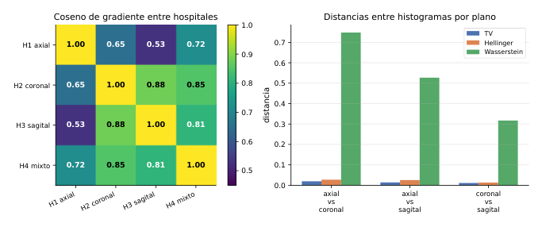
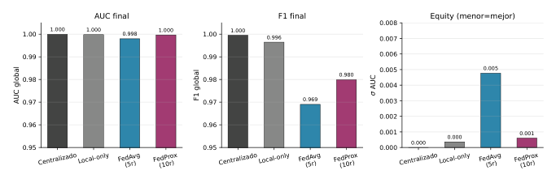
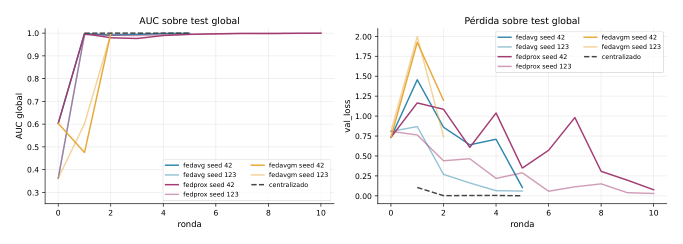
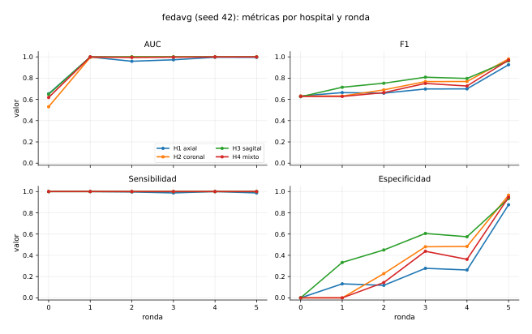
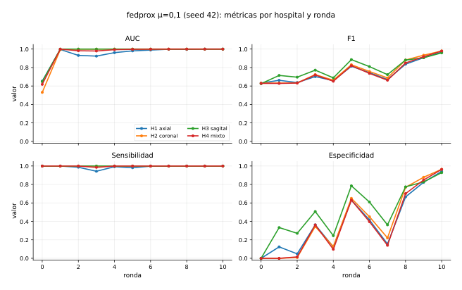
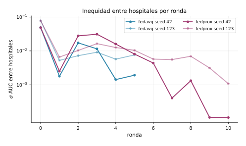
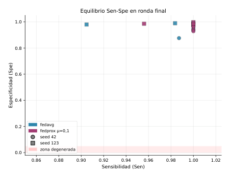

**English** | [Español](README.es.md)

# Federated transfer learning across anatomical planes

Pablo Jesús Delgado Muñoz, María Vázquez López, Paola Gambero Díaz. University of Málaga.

**[Paper (PDF, in Spanish)](paper.pdf)**

## Abstract

In this work we tackle Project 6 of the course, which sets up a federated transfer learning (FTL) scenario to classify MRI-FLAIR images as Multiple Sclerosis (MS) or control. The four simulated hospitals all use the same modality, but each one acquires the images in a different anatomical plane: axial, coronal, sagittal (or mixed). This introduces a visual domain shift that turns the problem into FTL instead of classic horizontal federated learning.

Before training we characterize the heterogeneity between hospitals in three different spaces and find that the real difference is not in the pixels but in the gradient space, where the mean cosine between clients is 0.74. We compare FedAvg and FedProx against local and centralized training bounds, using ResNet-18 without pretraining. FedAvg converges in 5 rounds with AUC = 0.998 and F1 = 0.969. FedProx with mu = 0.1 needs 10 rounds to get similar results (AUC = 0.9996, F1 = 0.980) because its proximal term struggles to get going when the initial global model is in a degenerate state. FedAvgM diverges to NaN in round 3 due to amplification of the bias between clients. The main conclusion is that FedAvg is the most robust and efficient option for this level of heterogeneity.

**Keywords:** federated transfer learning, medical imaging, MRI-FLAIR, FedAvg, FedProx, FedAvgM, ResNet-18.

## 1. Introduction

Federated learning (FL) makes it possible to train a shared model on data spread across several clients without moving it to a central server, exchanging only the model parameters [1]. This is very useful in healthcare, where patient data is protected by regulations like the GDPR that prevent it from being centralized outside the centre of origin [3]. On top of that, a single hospital usually has too little labelled data to train a reliable model on its own. Federation offers a solution: making use of everyone's data without anyone having to hand it over.

The most studied case in the field is horizontal federated learning (HFL), where all clients work with the same type of data and the same task, and only differ in the specific samples they have. The challenge in HFL is statistical heterogeneity: if each client's data has very different distributions (non-IID scenario), weight averaging can converge more slowly or even towards a model worse than the local ones. However, in hospital practice there is another kind of heterogeneity that is harder to deal with: different hospitals can acquire the same images with different protocols, which introduces visual differences between clients. When clients see the same type of image in modality but with different visual characteristics, as happens when the anatomical cutting plane changes, we talk about federated transfer learning (FTL). The key is that the label space Y(k) is the same for every client but the input space X(k) is not, because the same brain seen from axial, coronal or sagittal produces images that look very different to a convolutional network.

### Clinical context

Multiple Sclerosis (MS) is an inflammatory demyelinating disease of the central nervous system that affects more than two million people worldwide. Its diagnosis relies on magnetic resonance imaging, especially FLAIR sequences (*Fluid-Attenuated Inversion Recovery*), where periventricular demyelinating lesions appear as well defined hyperintensities once the cerebrospinal fluid signal is suppressed. Different centres acquire these volumes in different planes depending on their usual protocol: axial is the most common for quantifying total lesion load, coronal is used for the posterior fossa and the temporal lobes, and sagittal for evaluating the callosal band. This variability of planes between centres is exactly the FTL scenario we study: the clinical task is the same in every hospital, but the appearance of the images changes radically from one plane to another.

In this project we simulate four hospitals that all work with FLAIR sequences to classify MS versus control, but each one uses a different cutting plane. The goal is to analyse whether a federated model can integrate the information from these four views and generalize correctly to all of them, comparing which FL algorithm does it best with the lowest communication cost.

**Related work.** McMahan et al. [1] proposed FedAvg, which averages the client weights weighted by number of samples and is the reference algorithm in FL. Li et al. [2] analysed the main challenges of FL in non-IID scenarios, among them *client drift*, which happens when clients move too far from the global model while training locally for several epochs. To correct it, the same group proposed FedProx [4], which adds a proximal term to the local loss limiting how far each client can move from the global model. Hsu et al. [5] extended FedAvg with server momentum (FedAvgM) to speed up convergence, although with higher sensitivity to heterogeneity between clients. In federated medical imaging, Kaissis et al. [3] discuss the privacy implications and robustness challenges specific to the clinical domain. The base architecture used, ResNet-18, was proposed by He et al. [6] and is a standard in medical image classification tasks.

The report is organized as follows: Section 2 defines the problem as an FL network; Section 3 describes the algorithms and the implementation; Section 4 presents the experiments with all the results; Section 5 gathers the conclusions and future work.

## 2. Problem formulation

### Dataset

The data comes from the MRI-MS-KDE database, which contains 2D FLAIR MRI slices of MS patients and healthy controls in three anatomical planes. All images go through KDE (*Kernel Density Estimation*) preprocessing that normalizes the intensity histogram. This removes contrast differences between scanners and leaves the cutting plane as the only inter-client variation. Labels are per patient: all slices of an MS patient are labelled as MS, even if a specific slice has no visible lesion.

The federated partition assigns one plane to each simulated hospital (Table 1). The proportion of MS cases in training is 60% in every hospital, so there is no class imbalance between clients. The heterogeneity is purely visual.

**Table 1.** Dataset distribution per hospital.

| Hospital | Plane | Train slices | Test slices | MS |
|---|---|---|---|---|
| H1 | axial | 3 458 | 1 183 | 0.605 |
| H2 | coronal | 4 142 | 1 417 | 0.605 |
| H3 | sagittal | 3 458 | 1 001 | 0.605 |
| H4 | mixed | 3 583 | 1 073 | 0.619 |
| Global | - | - | 4 674 | 0.459 |

### Federated learning network

**Nodes.** Each node k in {1, 2, 3, 4} is a simulated hospital with its own slices from a specific anatomical plane. We checked that there is no patient overlap either between hospitals or between the train and test partitions.

**Local models.** All clients use the same architecture: ResNet-18 without pretraining [6], with the last fully connected layer replaced by a linear projection to a single logit. Images are loaded in grayscale, replicated to 3 channels to fit the input the ResNet expects, and resized to 224 x 224 px to remove resolution differences between planes. The total number of parameters is |w| = 11.177 M.

**Local loss function.** We use BCEWithLogitsLoss, which applies the sigmoid to the logit internally before computing the binary cross entropy, which is numerically more stable than doing it separately:

```
(1)  L_k(w) = -(1/n_k) * sum_{i=1..n_k} [ y_i * log(sigmoid(f_w(x_i))) + (1 - y_i) * log(1 - sigmoid(f_w(x_i))) ]
```

**Why this scenario is FTL.** All hospitals solve the same task (Y(k) = Y for every k), but each one looks at the brain from a different plane, so X(k) != X(k'). The marginal input distribution P(X) changes between clients while P(Y|X) stays the same. That defines FTL: the global model has to transfer what it learns in one plane to the others, not just average parameters of clients with similar data as in HFL.

**Topology.** We use a centralized star topology: the K = 4 clients only communicate with the server. At the start of each round the server sends w_g(t) to all clients; they train E epochs locally and send back w_k(t+1). Edges have weight n_k / sum_j n_j, proportional to the number of samples.

### Heterogeneity characterization

To understand the problem better before training, we quantify the difference between hospitals in three different spaces. **Distances between intensity histograms** (TV, Hellinger, Wasserstein-1) measure the difference at pixel level without taking spatial structure into account. **Distances between embeddings** of an untrained ResNet-18 (Fréchet, cosine between feature means) compare representations in feature space. **Gradient similarities** (cosine, norm of the difference) measure how similar the updates each client would make are if they started from the same model.

**Table 2.** Heterogeneity summary (mean over the 6 possible pairs).

| Metric | Space | Mean value |
|---|---|---|
| Total Variation between histograms | Pixels | 0.015 |
| Hellinger between histograms | Pixels | 0.022 |
| Wasserstein-1 between histograms | Pixels | 0.53 |
| Fréchet distance between embeddings | Features | 86.3 |
| Cosine between ResNet embeddings | Features | 0.977 |
| Local gradient cosine | Gradients | 0.739 |
| \|\|grad_i - grad_j\|\|_2 | Gradients | 5.11 |

The results in Table 2 and Figure 1 reveal something important: KDE preprocessing makes the hospitals almost identical in pixels (TV = 0.015) and also very similar in the space of learned representations (embedding cosine = 0.977). However, in gradient space the mean similarity drops to 0.739, with a minimum of 0.525 between H1 axial and H3 sagittal. If we had only looked at the histograms we would have concluded that the clients are almost the same, when in reality they differ quite a lot in how they optimize the model.



**Fig. 1.** Left: cosine between local gradients for each pair of hospitals. Right: distances between intensity histograms per pair of planes.

## 3. Methods

### Variation measure

To quantify the difference between models of different clients we use the squared Euclidean distance between their parameters:

```
(2)  phi(w_i - w_j) = ||w_i - w_j||_2^2
```

This measure appears explicitly in the FedProx proximal term and implicitly in the FedAvgM pseudo-gradient.

### Federated algorithms

We call w_g(t) the global weights at the start of round t and w_k(t+1) the weights of client k after E local epochs with Adam (eta = 1e-5).

**FedAvg [1].** The server computes the average of the local weights weighted by the number of samples of each client, with no regularization or memory between rounds:

```
(3)  w_g(t+1) = sum_{k=1..K} (n_k / sum_j n_j) * w_k(t+1)
```

It is the reference algorithm and the starting point to compare any variant.

**FedProx [4].** It modifies the local loss by adding a proximal term that limits how far each client can move from the global model:

```
(4)  L_prox_k(w) = L_k(w) + (mu / 2) * ||w - w_g(t)||_2^2
```

Aggregation on the server is the same as FedAvg; the difference is only in local training. It is implemented in `train_utils.py`: when `mu > 0` a copy of w_g(t) is saved before the epoch starts and the proximal term is added to the loss in every batch.

**FedAvgM [5].** It adds momentum on the server using the pseudo-gradient:

```
(5)  g_t = w_g(t) - sum_k (n_k / sum_j n_j) * w_k(t+1)
(6)  m_t = beta * m_(t-1) + g_t
(7)  w_g(t+1) = w_g(t) - eta_s * m_t
```

We use beta = 0.5 and eta_s = 0.5, which give a steady state effective step of eta_s / (1 - beta) = 1.0, the same as FedAvg. We chose this conservative configuration on purpose to give the algorithm the best possible conditions.

### Reference bounds

We train two baselines. *Local-only* trains a separate model in each hospital for T x E epochs, with no communication at all. If the federated model doesn't beat the local one, federation adds nothing for that hospital. *Centralized* puts together all the data from the four hospitals and trains a single model with the same compute budget; it is the theoretical upper bound, which in practice would be impossible for privacy reasons. Also, it is impossible for a federated learning model to be better than a centralized one in any possible case.

### Infrastructure

The implementation uses Flower [7] with PyTorch on an NVIDIA RTX 4000 series GPU. The four clients run as Ray actors sequentially. For reproducibility, the seed of each client and round is computed as `seed_base + cid + round`.

### Hyperparameters

Table 3 gathers the full configuration. All algorithms use the same compute budget so they can be compared fairly. We train without pretrained weights because otherwise the three algorithms saturate AUC ~ 1 from the first round and you can't tell which one works better.

**Table 3.** Experiment hyperparameters (ResNet-18 without pretraining).

| Parameter | Value | Comment |
|---|---|---|
| Initialization | random weights | no pretraining |
| Local epochs E | 2 | per round and client |
| Learning rate | 1e-5 | Adam |
| Batch size | 32 | |
| Gradient clipping | 0.5 | avoids exploding gradients |
| Weight decay | 1e-4 | L2 regularization |
| Seeds | {42, 123} | two repetitions |
| mu FedProx | 0.1 | proximal term |
| beta FedAvgM | 0.5 | server momentum |
| eta_s FedAvgM | 0.5 | server lr |
| Rounds FedAvg/FedAvgM | 5 | |
| Rounds FedProx | 10 | needs more to converge |

### Evaluation metrics

We use AUC-ROC (robust to threshold and class imbalance), F1-score with a 0.5 threshold, sensitivity and specificity separately, and Brier score to assess probability calibration. Fairness between hospitals is measured with sigma({AUC_k}): the lower, the more uniform the performance between clients. The communication cost is 2|w| x 4 ~ 85.3 MB per round (both directions).

## 4. Numerical experiments

### Global results

Figure 2 and Table 4 show the final metrics. The centralized and local-only baselines reach almost perfect results, which confirms that the task is relatively easy once KDE preprocessing normalizes the images. Among the federated algorithms, FedAvg is the best in terms of efficiency: it reaches AUC = 0.998 and F1 = 0.969 in only 5 rounds. FedProx gets slightly better results (AUC = 0.9996, F1 = 0.980), but needs 10 rounds, which means double the communication cost. FedAvgM does not converge with either of the two seeds.



**Fig. 2.** Comparison of final AUC, F1 and fairness across all methods. FedAvgM does not appear because it diverged.

**Table 4.** Final metrics on the global test set.

| Method | AUC | F1 | Sen / Spe | Equity |
|---|---|---|---|---|
| Centralized | 1.0000 | 0.9995 | 0.9995 / 0.9996 | 0.0000 |
| Local-only | 0.9998 | 0.9965 | 0.9959 / 0.9975 | 0.0004 |
| FedAvg (5 r.) | 0.998 +/- 0.001 | 0.969 +/- 0.009 | 0.984 / 0.960 | 0.005 |
| FedProx (10 r.) | 0.9996 +/- 0.0001 | 0.980 +/- 0.008 | 0.994 / 0.970 | 0.001 |
| FedAvgM | NaN | diverges in r3, both seeds | | |

### Convergence

Figure 3 shows the AUC and val_loss trajectories. FedAvg reaches a high AUC already in the first round and the loss goes down steadily to 0.06-0.11 in round 5. FedProx also climbs fast in AUC but its val_loss oscillates quite a lot in the first rounds and doesn't stabilize until round 7-8; it needs the full 10 rounds to settle. FedAvgM hits NaN in round 3 with both seeds and stops there.



**Fig. 3.** AUC and val_loss trajectories on the global test set per round. FedAvgM stops at r3 when it diverges to NaN.

### Per hospital analysis

Figures 4 and 5 detail the four metrics per hospital across rounds for FedAvg and FedProx (seed 42).

With FedAvg the four hospitals converge in a similar way. Specificity starts at 0 because the model begins by predicting MS almost always (the majority class in train), but it takes off from round 3 and ends above 0.87 in every hospital. H1 axial is the slowest, which makes sense because it is the most different plane in gradient space (minimum cosine 0.525 against H3 sagittal).

FedProx has the same initial problem with specificity, but takes longer to solve it. This happens because the proximal term anchors each client to the global model, which at the start is an almost always positive predictor. With mu = 0.1 the anchoring isn't too strong and the model ends up converging, but it needs quite a few more rounds. In round 5 the FedProx specificity on H1 is only 0.63, while FedAvg is already at 0.88.



**Fig. 4.** FedAvg (seed 42): AUC, F1, sensitivity and specificity of the aggregated model evaluated on each hospital per round.



**Fig. 5.** FedProx mu = 0.1 (seed 42): same metrics over 10 rounds. Specificity oscillates in the first rounds and doesn't stabilize until round 7-8.

### Fairness and final metrics per hospital

Figure 6 shows the standard deviation of AUC between hospitals per round. FedAvg ends with sigma = 0.0048, which means less than 0.5% difference between the best and the worst hospital. FedProx reaches sigma = 0.0006 at the end of its 10 rounds, a higher fairness. Figure 7 shows that FedAvg groups all hospitals in the top right corner (Sen ~ 0.99, Spe ~ 0.94-0.99), while FedProx has a slightly wider range in specificity.



**Fig. 6.** Standard deviation of AUC between hospitals per round. Log scale.



**Fig. 7.** Sensitivity versus specificity in the final round, per algorithm, seed and hospital. The top right corner is the goal; the bottom band is the predictor that always says positive.

Table 5 details the final results per hospital and seed. H1 axial is the hardest: it has the lowest F1 with FedAvg (0.926-0.938) and the lowest specificity with FedProx (seed 42 ends at 0.942 after 10 rounds). H2 and H3 are the easiest; H4 (mixed) sits in between.

**Table 5.** Final metrics of the aggregated model per algorithm, seed and hospital.

| Alg. | Seed | Hospital | AUC | F1 | Sen | Spe |
|---|---|---|---|---|---|---|
| FedAvg (r5) | 42 | H1 axial | 0.9953 | 0.9261 | 0.9872 | 0.8760 |
| | | H2 coronal | 1.0000 | 0.9805 | 1.0000 | 0.9659 |
| | | H3 sagittal | 0.9998 | 0.9619 | 1.0000 | 0.9341 |
| | | H4 mixed | 0.9992 | 0.9694 | 1.0000 | 0.9467 |
| | 123 | H1 axial | 0.9820 | 0.9383 | 0.9048 | 0.9796 |
| | | H2 coronal | 1.0000 | 0.9962 | 1.0000 | 0.9934 |
| | | H3 sagittal | 1.0000 | 0.9902 | 1.0000 | 0.9835 |
| | | H4 mixed | 0.9986 | 0.9857 | 0.9837 | 0.9897 |
| FedProx (r10) | 42 | H1 axial | 0.9997 | 0.9672 | 1.0000 | 0.9419 |
| | | H2 coronal | 1.0000 | 0.9798 | 1.0000 | 0.9646 |
| | | H3 sagittal | 0.9999 | 0.9589 | 1.0000 | 0.9286 |
| | | H4 mixed | 0.9997 | 0.9791 | 1.0000 | 0.9639 |
| | 123 | H1 axial | 0.9975 | 0.9694 | 0.9560 | 0.9859 |
| | | H2 coronal | 1.0000 | 0.9985 | 1.0000 | 0.9974 |
| | | H3 sagittal | 1.0000 | 0.9913 | 1.0000 | 0.9853 |
| | | H4 mixed | 0.9999 | 0.9909 | 1.0000 | 0.9845 |
| FedAvgM | - | - | NaN in r3, both seeds | | | |

### Why FedAvgM diverges

FedAvgM fails because of an amplification problem. At the start of training the global model starts from random weights and tends to predict MS almost always, which is the majority class in train. The four clients agree on pushing the bias in the same direction (towards positive) in the first rounds. The server momentum accumulates that direction round after round with nothing to stop it. In round 3 the logits grow so much that the sigmoid returns exactly 1 due to rounding error and the BCE becomes infinite.

We tried to prevent it using beta = 0.5 and eta_s = 0.5 (effective step equal to FedAvg), plus gradient clipping and other techniques, but it wasn't enough. Regularization slows the problem down but doesn't remove it. For FedAvgM to work here, you would have to either reduce beta below 0.1, or correct the logit bias on the server before accumulating the momentum.

### Communication cost

Each round means transferring 2 x 11.177M x 4 ~ 85.3 MB between server and clients. With 5 rounds FedAvg accumulates ~426 MB in total, while FedProx with 10 rounds needs ~853 MB to get slightly better results. The time per round is around 290 s for all algorithms; the FedProx proximal term doesn't add noticeable time. Table 6 compares the total cost and final result of each algorithm.

**Table 6.** Summary of communication cost and final result per algorithm.

| Method | Rounds | Total MB | Final AUC | Final F1 |
|---|---|---|---|---|
| FedAvg | 5 | 426 | 0.9980 | 0.9690 |
| FedProx mu = 0.1 | 10 | 853 | 0.9996 | 0.9799 |
| FedAvgM | - | - | NaN | NaN |

### FedAvgM trajectory before diverging

Although FedAvgM fails, the trajectory before the NaN is informative. Table 7 shows the global metrics and per hospital specificity in the rounds that get completed.

**Table 7.** FedAvgM trajectory (beta = 0.5, eta_s = 0.5) before diverging. Sen = 1.000 in every round. Spe: mean over the 4 hospitals.

| Round | AUC (s42) | AUC (s123) | Mean Spe (s42) | val_loss (s42) |
|---|---|---|---|---|
| r0 | 0.603 | 0.363 | 0.000 | 0.735 |
| r1 | 0.475 | 0.601 | 0.000 | 1.925 |
| r2 | 0.999 | 0.997 | 0.115 | 1.199 |
| r3 | NaN | NaN | NaN | NaN |

### Distances between hospitals

Table 8 breaks down the heterogeneity metrics for each pair of hospitals. H1 axial is the furthest from the rest, especially from H3 sagittal. H2 coronal and H3 sagittal are the most similar (gradient cosine 0.879) since they share the superior-inferior orientation of the brain. H4 mixed sits in between because it mixes the three planes in equal parts.

**Table 8.** Heterogeneity metrics per pair of hospitals. W1: Wasserstein-1; cos_emb: embedding cosine; cos_grad: gradient cosine.

| Pair | TV | Hellinger | W1 | cos_emb | cos_grad | \|\|delta g\|\| |
|---|---|---|---|---|---|---|
| H1-H2 | 0.020 | 0.027 | 0.748 | 0.978 | 0.651 | 6.02 |
| H1-H3 | 0.014 | 0.025 | 0.527 | 0.952 | 0.525 | 6.87 |
| H1-H4 | 0.016 | 0.024 | 0.638 | 0.987 | 0.719 | 5.19 |
| H2-H3 | 0.011 | 0.013 | 0.317 | 0.972 | 0.879 | 3.83 |
| H2-H4 | 0.012 | 0.018 | 0.452 | 0.995 | 0.848 | 4.21 |
| H3-H4 | 0.013 | 0.019 | 0.481 | 0.983 | 0.811 | 4.64 |
| Mean | 0.015 | 0.022 | 0.527 | 0.977 | 0.739 | 5.11 |

### Overfitting detection

To detect overfitting, in the code (`train_utils.py`) we compare the training loss and the validation loss at every local epoch. Since the dataset has no separate validation partition, we use the test samples only for monitoring; we don't make any decision about the parameters based on them. For FedAvg the final val_loss is 0.106 for seed 42 and 0.060 for seed 123, both close to the train_loss, which points to correct calibration without catastrophic overfitting. For FedProx the val_loss oscillates more in the first rounds but stabilizes in the last ones.

### Rounds needed by FedProx

Running FedProx for 5 rounds gives clearly worse results than FedAvg in the same 5 rounds: the H1 specificity with FedProx in round 5 is only 0.631 (seed 42), versus 0.876 for FedAvg. With 10 rounds FedProx recovers and beats that specificity (0.942), but at the cost of double the communication.

The H1 specificity trajectory for FedProx seed 42 shows that the oscillation is real and not a seed artifact: 0.000 -> 0.124 -> 0.049 -> 0.363 -> 0.124 -> 0.631 -> 0.416 -> 0.155 -> 0.666 -> 0.824 -> 0.942. So we conclude that in deployments with communication constraints, FedAvg is the only robust option of the two.

## 5. Conclusion

The results confirm that federation works well in this FTL scenario. The federated models generalize to the four anatomical planes without any hospital having to hand over its data, and the results are comparable to centralized training in most metrics.

### FedAvg as the robust option

FedAvg is the best option in terms of performance to cost ratio in this scenario. With only 5 rounds it reaches AUC = 0.998 and F1 = 0.969, with fairness between hospitals of sigma = 0.005. Table 9 summarizes the differences between algorithms numerically to make the comparison easier.

**Table 9.** Results of the three algorithms. Mean values over seeds 42 and 123. FedProx needs 10 rounds; FedAvg and FedAvgM use 5.

| Algorithm | AUC | F1 | Sen | Spe | sigma AUC |
|---|---|---|---|---|---|
| FedAvg (5 r.) | 0.9980 | 0.9690 | 0.984 | 0.960 | 0.0048 |
| FedProx (10 r.) | 0.9996 | 0.9799 | 0.994 | 0.970 | 0.0006 |
| FedAvgM | NaN | NaN | NaN | NaN | NaN |
| Centralized | 1.0000 | 0.9995 | 1.000 | 1.000 | 0.0000 |
| Local-only | 0.9998 | 0.9965 | 0.996 | 0.998 | 0.0004 |

Moderate heterogeneity between clients (gradient cosine between 0.5 and 0.9) doesn't justify more complex algorithms: when clients don't drift in very opposite directions, FedAvg's weighted average is enough to get a good global model.

A result worth highlighting is that H1 axial is the hardest hospital for every algorithm. Axial images are the most different from the rest in gradient space (minimum cosine 0.525 against H3 sagittal, versus 0.879 between H2 and H3). The federated model takes longer to classify the axial plane well because H1's updates point in a direction further away from the mean than the rest.

### FedProx: better final result but higher cost

FedProx with mu = 0.1 reaches slightly better results than FedAvg (AUC = 0.9996, F1 = 0.980, sigma = 0.0006), but only after 10 rounds. The problem is that the proximal term anchors each client to the global model, which at the start is an almost always positive predictor because it starts from random weights and MS is the majority class in training. That anchoring holds back the ability of the clients to correct specificity in the first rounds, producing the oscillation seen in Figure 5. With double the rounds and double the communication cost (~853 MB versus ~426 MB for FedAvg), FedProx converges and slightly beats FedAvg in the final metrics. The practical question is whether that small improvement justifies the extra cost; in this scenario, with moderate heterogeneity, the answer is probably no.

### FedAvgM: a structural amplification problem

FedAvgM fails because of a problem that isn't solved by tuning hyperparameters within reasonable values. The server momentum accumulates the update direction of all previous rounds. At the start all clients push the model in the same direction (towards the positive class), and that bias gets amplified cumulatively until the logits explode. It's not a problem of an insufficiently conservative configuration: we used the lowest possible effective step (eta_s / (1 - beta) = 1.0, the same as FedAvg) plus gradient clipping and weight decay, and it still diverges. The solution would require either a much lower beta (practically zero), or an active correction of the logit bias on the server before accumulating the momentum.

### Finding: the real heterogeneity is in the gradients

Maybe the most interesting result of the project isn't the performance of the algorithms but the prior heterogeneity analysis. If we had stuck to the distances between pixel histograms (TV = 0.015) or the distances between embeddings (cosine = 0.977), we would have concluded that the four hospitals are almost identical and that federation isn't needed. However, in gradient space the mean similarity is 0.739 with a minimum of 0.525. This shows that to diagnose whether an FL scenario is really hard you have to look at metrics in the optimization space, not only in the input space.

### Limitations

We only simulated four hospitals with a balanced class distribution, which is an undemanding scenario for real FL. With more clients and higher heterogeneity the results could be different: maybe FedProx would be more clearly better than FedAvg if the gradient cosine dropped below 0.4 or 0.3. We only used two seeds, so the variance is poorly estimated. Patient level labels make the task easier compared to what would be clinically needed for lesion by lesion detection. Simulating on a single machine with Ray actors doesn't capture network latency, clients dropping out in the middle of a round (stragglers), or hardware heterogeneity between centres. Finally, we didn't evaluate the impact of KDE preprocessing: without it, pixel heterogeneity would be much higher and the results could change.

### Future work

The most direct line would be trying FedProx with a smaller mu (0.01 or even 0.001) to see if it converges in fewer rounds while keeping the final metrics. It also makes sense to do a warmup of 2-3 FedAvg rounds before turning on the proximal term, so the global model is already in a reasonable state when FedProx starts anchoring.

For FedAvgM, reducing beta to 0.1 or less should fix the divergence, although the benefit of momentum would be very limited or practically non-existent.

In the longer term it would be worth extending the experiment to more hospitals with a wider variety of heterogeneity, comparing with more recent algorithms, and exploring whether the results hold when the task goes from per patient classification to a more complex problem.

### Reflection on the FTL scenario

From a teaching point of view, this project shows well why FTL is harder than standard HFL. In HFL, heterogeneity between clients can be measured easily by comparing the distributions of their data. In FTL, the data of different clients lives in different input spaces and the usual distance metrics in pixel or representation space don't capture the real difficulty of the optimization problem. Gradient metrics are much more informative because they directly measure how much the clients will "pull" in different directions during training.

It's also interesting that FedAvg, being the simplest algorithm, is the most suitable one when heterogeneity is moderate. More complex algorithms like FedProx or FedAvgM add mechanisms designed for high heterogeneity situations, and when that heterogeneity isn't so large, those mechanisms bring more problems than advantages. In this case the FedProx proximal term makes the initial calibration harder and the FedAvgM momentum amplifies a bias that FedAvg corrects on its own through the average.

Finally, the results show that a well designed federated system can produce models that work well in every hospital with an AUC difference between the best and the worst of less than 0.5% (with FedAvg). This is a positive result for the goal of fairness between centres, which is especially important in medical applications: we don't want the model to work really well in the hospital with the most data and really badly in the rest.

## 6. References

1. B. McMahan, E. Moore, D. Ramage, S. Hampson and B. A. y Arcas, "Communication-efficient learning of deep networks from decentralized data," in *Proc. AISTATS*, 2017.
2. T. Li, A. K. Sahu, A. Talwalkar and V. Smith, "Federated learning: Challenges, methods, and future directions," *IEEE Signal Process. Mag.*, vol. 37, no. 3, pp. 50-60, 2020.
3. G. A. Kaissis, M. R. Makowski, D. Rückert and R. F. Braren, "Secure, privacy-preserving and federated machine learning in medical imaging," *Nature Mach. Intell.*, vol. 2, no. 6, pp. 305-311, 2020.
4. T. Li, A. K. Sahu, M. Zaheer, M. Sanjabi, A. Talwalkar and V. Smith, "Federated optimization in heterogeneous networks," in *Proc. MLSys*, 2020.
5. T.-M. H. Hsu, H. Qi and M. Brown, "Measuring the effects of non-identical data distribution for federated visual classification," arXiv:1909.06335, 2019.
6. K. He, X. Zhang, S. Ren and J. Sun, "Deep residual learning for image recognition," in *Proc. CVPR*, pp. 770-778, 2016.
7. D. J. Beutel et al., "Flower: A friendly federated learning research framework," arXiv:2007.14390, 2020.
8. A. Jung, *Federated Learning: From Theory to Practice*. Aalto, 2025.
9. A. Jung, *Machine Learning: The Basics*. Springer, 2022.

---

## Code

### Repository contents

```
p6/
├── run_all.py            Runs the experiments
├── src/                  Project code
│   ├── config.py         Paths and params
│   ├── dataset.py        Image and CSV loading
│   ├── model.py          Resnet18
│   ├── train_utils.py    Local training and metric computation
│   ├── baselines.py      Local-only and centralized
│   ├── federated.py      Federated simulation with Flower
│   ├── fl_client.py      Flower client
│   └── fl_server.py      Server and FedAvg / FedProx strategies
├── results/              Metrics, models
├── pyproject.toml        Dependencies
```

### Data

The images are not included in the repository because of their size. They have to be placed in the data/ folder, which config takes as root.

The split of images between hospitals is given by the 06_hfl_cls_plane_comparison_flair CSVs, their path can be set in the config file.

### Requirements and running

Dependencies are in pyproject.toml and the project is managed with uv:

```bash
uv run python run_all.py
```

run_all.py trains centralized, local-only, FedAvg and FedProx, and saves the results in /results. A single experiment can be run with:

```bash
uv run python run_all.py --only fedavg
```

Other params like --rounds, --lr, --local-epochs are supported from run_all or config.py
